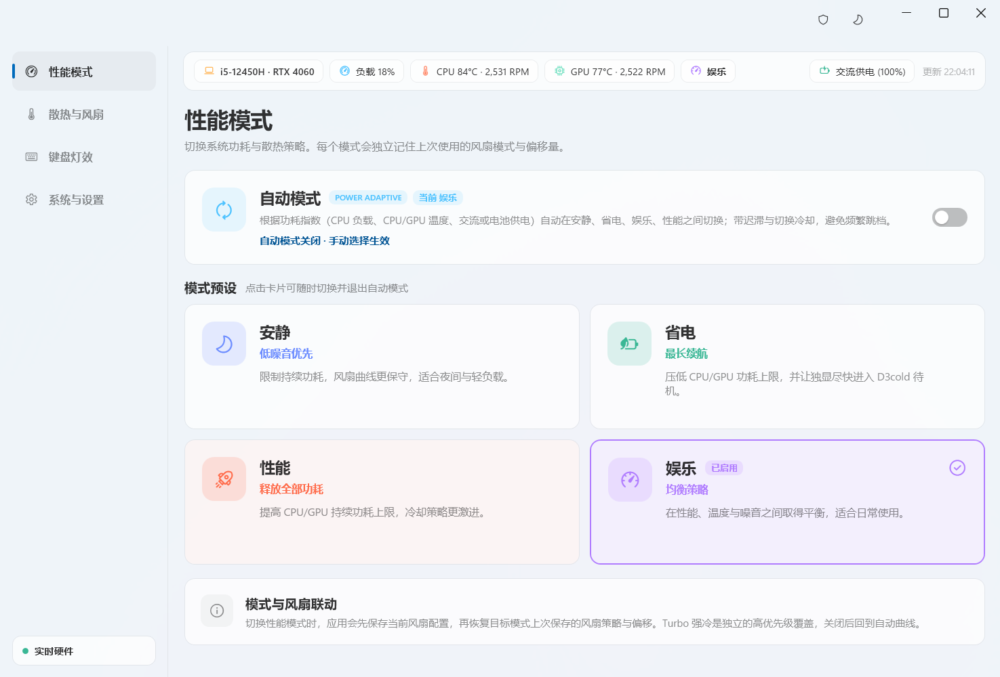
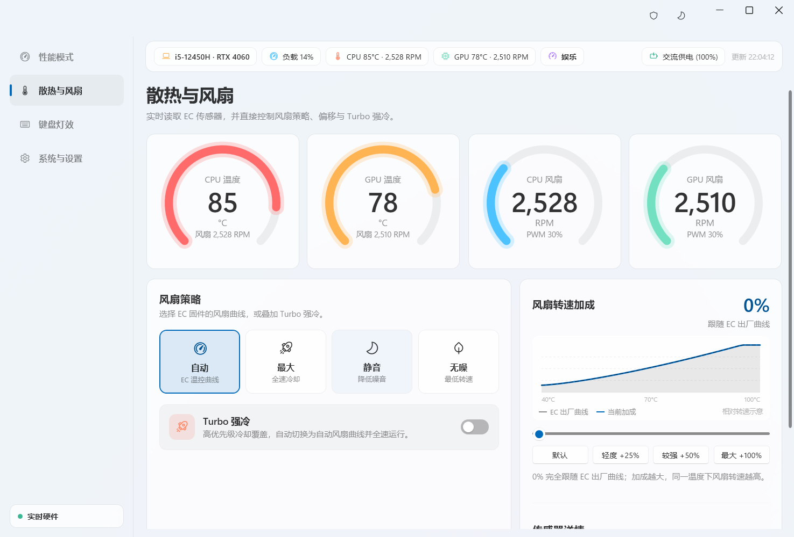

# Clevo Control Panel

[](LICENSE)

> 轻量、便携的蓝天（Clevo）模具控制面板 —— 用原生 WPF 替代笨重的原厂 Control Center，直接通过 InsydeDCHU / ACPI Bridge 控制 EC。





## 这个软件解决了什么

- **原厂 Control Center 太重**：依赖 UWP/Appx、启动慢、常驻服务多。本项目是单文件便携的 WPF 应用，启动快、占用低。
- **原厂服务会覆盖设置**：CCDCHUService 可能在后台重置风扇/性能设置；本应用支持挂起官方服务，保证当前配置不被覆盖。
- **大多数用户只需要核心功能**：性能模式、风扇策略与偏移、Turbo、温度/转速监控、键盘背光、托盘常驻。本项目只做这些，并把它们做直观。
- **跨机型复用**：同类蓝天模具的 EC 协议高度相似，但键盘类型、风扇数量和能力位不同。本项目会读取能力信息，按机型启用/禁用对应功能。

## 功能

- **性能模式**：安静 / 省电 / 性能 / 娱乐，以及基于功耗指数的自动模式（带迟滞、冷却与切换防抖）。
- **风扇控制**：自动 / 最大 / 静音 / 无噪，Turbo 强冷，0–100% 风扇转速加成。
- **曲线可视化**：显示 EC 出厂曲线与当前加成曲线的差异，0% 语义明确为"跟随出厂曲线"。
- **状态监控**：CPU/GPU 温度、风扇 RPM 与 PWM、GPU 电源状态、主板温度、电源/电池状态、托盘实时摘要。
- **键盘灯效**：整块键盘统一调色、四档亮度、开关、EC 休眠计时、呼吸/循环/波浪/闪烁。
- **常驻与安全**：关闭到托盘、开机自启、高温应急强冷熔断、自动模式、OEM 服务接管。
- **原生浅色界面**：无品牌字样、无边框图标按钮、柔和开关、原生 Fluent 风格。

## 创新点

1. **直接走 EC 通道**：使用 Command 103/121 + AppSettings 完成风扇、性能、灯效和 NVRAM 持久化，不依赖 UWP 应用或原厂前端。
2. **OEM 服务接管**：可挂起 CCDCHUService，避免后台定时重置风扇/性能模式；需要时一键恢复官方服务。
3. **应用侧灯效引擎**：部分蓝天键盘固件不执行 EC 动画。本项目由应用以 10 FPS 直接下发三区颜色帧实现呼吸/循环/波浪/闪烁，速度可调，退出时恢复常亮。
4. **机型能力检测与降级**：读取 WMI/键盘类型/风扇能力位；白色背光键盘隐藏颜色与灯效，无风扇/无偏移机型禁用对应控制，未知机型进入兼容模式并提示风险。
5. **面向真实设备的 UI**：单区键盘统一调色、无分区假控件；风扇加成用语义预设 + 相对曲线示意，而不是只给一个百分比。
6. **完整的自动散热策略**：自动模式按 CPU 负载、温度、供电状态选择模式；高温熔断在 CPU ≥ 94°C / GPU ≥ 86°C 时强制强冷，降温后恢复。

## 兼容性

- **平台**：蓝天（Clevo）模具 / 同平台贴牌机，使用 InsydeDCHU.dll + AcpiBridge 驱动。
- **已验证机型**：COLORFUL P15 24（i5-12450H + RTX 4060）。
- **其他机型**：应用会读取键盘/风扇能力并显示“机型兼容性”卡片。未验证机型启动时会提示兼容模式，建议先小范围测试风扇与灯效。
- **键盘**：白色/15 色背光机型自动禁用 RGB；分区/单键 RGB 机型当前按整块统一调色（不做单键编辑）。
- **非 Clevo 平台**：检测不到 DCHU/有效遥测时进入模拟模式，仅展示界面，不会控制硬件。

## 运行要求

- Windows 10 / 11 x64
- .NET 8 Desktop Runtime（或使用自包含发布）
- 原厂 Control Center 的 `InsydeDCHU.dll` 与 `AcpiBridge.sys` 驱动（**本仓库不分发 OEM 二进制**）
- 控制/接管官方服务需要管理员权限

## 构建

```bash
dotnet build src/ClevoControlPanel.App/ClevoControlPanel.App.csproj -c Release -p:Platform=x64

dotnet publish src/ClevoControlPanel.App/ClevoControlPanel.App.csproj \
  -c Release -p:Platform=x64 -r win-x64 --self-contained false \
  -p:PublishSingleFile=true -o dist
```

OEM 的 `InsydeDCHU.dll` 不包含在仓库中。构建项目时会在该文件存在时自动复制；运行时也会尝试从原厂 Control Center 安装目录加载。如需独立分发，请自行确认 OEM 组件的再分发许可，或要求用户先安装原厂驱动。

## 测试

```bash
dotnet test tests/ClevoControlPanel.Core.Tests/ClevoControlPanel.Core.Tests.csproj -c Release
dotnet test tests/ClevoControlPanel.Tests/ClevoControlPanel.Tests.csproj -c Release
```

当前：313 项核心测试 + 137 项应用/交互测试。

## 项目结构

```
src/
  ClevoControlPanel.Core/   EC 通信、遥测解析、风扇/灯效/能力检测
  ClevoControlPanel.App/    WPF + WPF-UI 界面、托盘、About
tests/
  ClevoControlPanel.Core.Tests/
  ClevoControlPanel.Tests/
docs/                       截图
```

## 关于

- 版本：1.0.0
- 作者：**xukuncai**
- 邮箱：**xukuncai0001@gmail.com**

## 许可证

本项目代码采用 [MIT License](LICENSE) 开源。

OEM 的 `InsydeDCHU.dll`、AcpiBridge 驱动及固件不包含在本仓库中，其使用与再分发仍受原厂许可约束。

## 免责声明

本项目为个人独立开发，与 Clevo、Insyde 及任何 OEM 厂商无关联。风扇、功耗与灯效控制存在硬件风险，请自行评估并在自己的机型上小范围验证。
